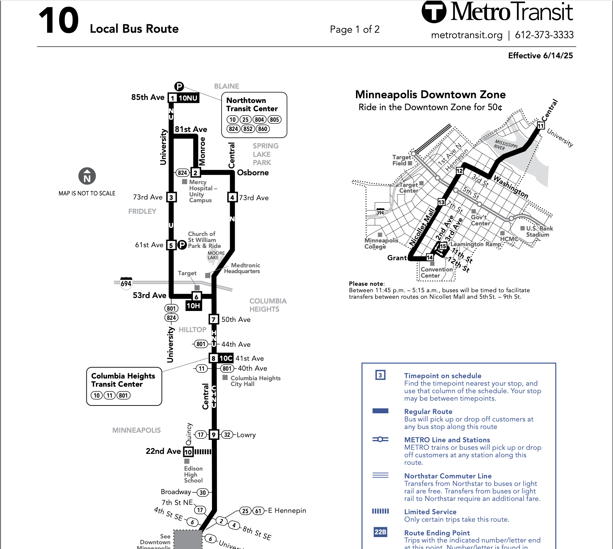
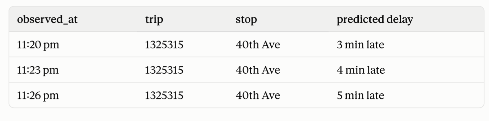

```{r}
# loading the libs
library(tidyverse)
library(ggplot2)
library(arrow)
```


```{r}
# Dataset 

parquet_path <- "../metro-transit-gtfs/data/clean/trip_updates" # since I saved the data in parquet form for as it makes analytical queries 100 times faster

# the open_dataset() function is a part of arrow library is for my situation it inshort since I have many files of parquet data it allows me to query data againg data that's split across many files and returns a clean dataset  [ AI Statement:  I asked AI the function ]
trip_updates_dataset <- open_dataset( 
  parquet_path,
  format = "parquet",
  hive_style = FALSE 
)


# I'm creating the clean dataset and doing few filters and mutates to have better columns for analysis 
# This is just specifically route 10 data that we have 
route_10_df <- trip_updates_dataset %>%
  filter(route_id == "10") %>%
  filter(!is.na(effective_delay_sec)) %>%
  collect() %>%
  mutate(
    observed_at_utc = ymd_hms(observed_at_utc, tz = "UTC"),
    observed_at_ct = with_tz(observed_at_utc, tzone = "America/Chicago"),
    delay_minutes = effective_delay_sec / 60,
    delay_status = case_when(
      delay_minutes < -1 ~ "Early",
      delay_minutes <= 1 ~ "On time (within 1 minute)",
      TRUE ~ "Late"
    )
  )

# Dataset explore 
head(route_10_df)
view(route_10_df)
glimpse(route_10_df)

```






```{r}
#| fig-cap: Kaplan-Meier survival curve.
#| fig-alt: Plot of a Kaplan-Meier survival curve.


# hour func to have 24 hr clock --  \h is a short form of writing a func same as lambda funcs in Python
hr <- \(h) paste0(ifelse(h %% 12 == 0, 12, h %% 12), ifelse(h < 12, "am", "pm"))  # 17 -> "5pm"


# Prepping data for viz
late <- route_10_df |>
  #Since the feed repeats the same stop many times as the bus approaches, we're only Keeping only the last prediction per stop/trip/day so we count arrival just once not skew percetages.Explained with clear Pic
  mutate(day = as.Date(observed_at_ct)) |>
  slice_max(observed_at_utc, by = c(trip_id, stop_id, day), with_ties = FALSE) |>
  # Using the hour the bus is SCHEDULED as that is what riders and planners think in. 
  mutate(hour = as.integer(substr(scheduled_arrival, 1, 2)) %% 24) |>
  # Share of arrivals 5+ minutes behind schedule, per hour and direction
  summarise(pct_late = mean(delay_minutes >= 5) * 100, n = n(), .by = c(hour, trip_headsign)) |>
  filter(n >= 5)  # kinda saying ignore the hours with too little delays


# labels for where its heading
dir_labels <- c("Central-41"                         = "Northbound: to Columbia Heights/ (41st Ave)",
                "Downtown Minneapolis / Via Central" = "Southbound: to Downtown Minneapolis")


# Viz
ggplot(late, aes(hour, pct_late, fill = pct_late)) +
  geom_col() +
  geom_text(aes(label = paste0(round(pct_late), "%")), vjust = -0.4, size = 4) +  # numbers on bars 
  facet_wrap(~trip_headsign, ncol = 1, labeller = as_labeller(dir_labels)) +                                           # one panel per dir
  scale_fill_gradient(low = "gold", high = "firebrick", guide = "none") +          # colour 
  scale_x_continuous(breaks = seq(0, 22, 2), labels = hr) +
  scale_y_continuous(labels = \(x) paste0(x, "%"), expand = expansion(mult = c(0, .2))) +
  labs(title = str_wrap(paste0("When and where does Route 10 experiences most % of delays?"), 60),   
       subtitle = str_wrap("Taller and redder means more buses running at least 5 minutes behind schedule.", 80),
       x = "Hour of day the bus is scheduled to arrive", y = "Stops where bus is 5+ mins late",
       caption = "Source: Metro Transit GTFS-realtime trip updates from Official Website; hours with under 5 observations hidden.") +
  theme_minimal(base_size = 13) +
  theme(plot.title.position = "plot", plot.title = element_text(face = "bold", size = 16))

```

### AI Statement : I used Perplexity to help me with code when I was having errors with scaling geom_text and making it look aesthetically good. I have viewed myself the code and added my own comments to make things clear and guide anyone who wants to understand the code. 

#Description of the Vizualization: 

So as the title suggest, I wanted to look at when as in what time of the day and where as in where the bus is headed to had most amount of delays as in delays of more than 5 mins for Route 10 which runs between downtown Minneoplois and northen subrubs (such as Columbia Heights and Blaine/Northtown), primarily travelling via central Avenue. I wanted to basically have a visualization that is actionable(inspiration from example projecst) and gives great insight so that it can be taken action on by Metro Transit. We see that buses travelling  northbound towards columbia heights have approximately 60% of its buses delayed by more than 5 minutes so roughly speaking 2/3 buses is delayed by more than 5 minutes at 12 pm midnight - which is a big portion of delays and accounts for highest % of delays in our viz.Similarly followed by than we have 44% (roughly 1/2)  Buses at 11 pm going to columbia heights where passesnger and riders have wait for more 5 minutes at stops. Lastly, we see that passengers and riders have to wait more than 5+ minutes at stops in downtown minneopolis when route 10 is heading south at 11pm and 41% of buses are delayed. One of my suggestions to Metro Transit is it can either increases buses at night time for route 10 or reschedule and add an extra 5-10 minutes buffer time when considering relseasing scheduled arrival time. 


